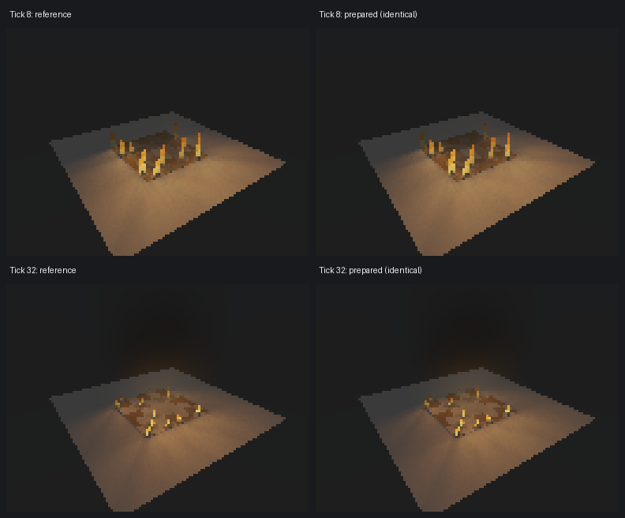

# Bounded Fire render qualification — October 5, 2026

This Main Edit checkpoint completes two ordered local source slices: exact all-source incident-sample preparation, then an opt-in stylized omnidirectional Fire adapter. It preserves the accepted native Fire snapshots and their PhysicsSim smoke carriers. It is ready for source and visual review; installed editor acceptance and physical fire qualification remain open.

## Exact performance slice

Source commit `3809ff5` prepares source geometry once per volume ray, then batches the four legacy rectangle incident samples at each occupied march point. The receiver seed is shared within that batch. The prepared source is a copy scoped to the ray, freed at its end; there is no frame-spanning cache of geometry, material, enabled state, volume, time, receiver or visibility. Allocation failure retains the original individual-sample path. `RAY_TRACING_VOLUME_INCIDENT_REFERENCE=1` selects that reference path on the same worker. Other source models retain their original sampling helper.

Profiling identified incident connection visibility as the dominant work. An initial geometry-before-extinction experiment produced identical pixels but ran slower and was discarded. The delivered preparation retains every supported source, source sample, visibility connection, angular profile and RGB weight. It changes neither the smoke nor render settings and claims no approximate error budget.

The paired 128×96, one-worker, one-temporal-pass benchmark renders frozen ticks 8 and 32 twice in each mode, reversing order for the second pair:

| Tick | Reference runs (s) | Prepared runs (s) | Mean reference → prepared | Mean improvement |
| --- | --- | --- | --- | --- |
| 8 | 117.937, 127.748 | 97.519, 124.396 | 122.843 → 110.957 s | 9.68% |
| 32 | 121.525, 108.320 | 113.316, 104.148 | 114.923 → 108.732 s | 5.39% |

Timing varies with local load; these two-sample means establish this bounded observation, not a general speed guarantee. Benchmark worker SHA-256 is `a43dadb597a5b7e967d1051a4fcff65a6d999b153393bbbebc805793eca71fed`. It precedes final null/NaN guard refinements. A separate 64×48 same-worker reference/prepared comparison on the final source worker also passes byte parity; its concurrent timings are excluded.

All eight benchmark BMPs are byte-identical within their tick: tick 8 SHA-256 `dc8dee12288e6f02af893ff752d7ad39ceb3736f4d0b3474b1fe3202c5912ae7`, tick 32 `e7382cba02d46806a45461492be965fa906ed072f1494cfb34ac2cf2bed21c52`. Maximum RGB byte error and differing-pixel count are zero. The following work totals are unchanged in every repeat:

| Tick | Source evaluations | Visibility connections | Contributing samples | Unsupported / fallback |
| --- | ---: | ---: | ---: | ---: |
| 8 | 10,370,409 | 19,933,684 | 15,164,853 | 0 / 0 |
| 32 | 10,386,383 | 21,226,692 | 17,927,096 | 0 / 0 |

## Independent omnidirectional illumination

RayTracing source commit `534b3c6` adds the optional boolean `extensions.ray_tracing.authoring.object_materials[].emissive_visual_proxy`. A true value requires a matching `plane_primitive`; malformed types, missing objects and non-plane objects reject preflight. Absence or false retains ordinary material behavior. Runtime-scene save/reopen preserves the flag; scene config stores `emissiveVisualProxy`.

Designated planes retain visible hit emission and ordinary camera opacity, while they are excluded from material-light registration and the direct-emitter full-scan fallback. Direct incident visibility skips only designated proxies. Ordinary geometry, real opaque walls, source/target endpoint identity, transparent transmission and smoke extinction remain active. The conservative traversal budget returns zero when exhausted rather than leaking past an unvisited blocker. Scenes containing proxies use the general visibility path. This qualification covers Direct Light surface shading and volume single scattering; recursive integrators, photon emission and general indirect transport are not qualified here.

GrowthSim adapter commit `c6d1878` adds `--lighting-model omni_proxies`; `surface_cards` remains the default and reproduces the frozen legacy scenes. Up to twelve selected Fire columns each supply a zero-radius, legacy-intensity RGB point source at the middle of the authored flame height, with color `(1,138/255,44/255)`, falloff distance 0.45 m and intensity `(3*burn + 0.5*ember)*flicker`. These sources have omnidirectional incident weights. Their distance falloff has no finite support. This source count is an adapter budget, not renderer truncation of an imported registry.

Visible card strength uses `(0.15 + 0.65*burn)*flicker`, and the warm base uses `0.45*burn + 0.2*ember`, keeping this qualification inside the existing [0,1] material-strength limit. The legacy cards exceeded that importer limit; their frozen mapping is unchanged. No global material clamp was raised. New cards are visual proxies and cannot duplicate point-source lighting.

A thirteenth enabled point with intensity zero satisfies the current headless frame's `hasLight` precondition. It contributes zero illumination and avoids compatibility fallback, including at the extinct snapshot and with all positive Fire sources disabled. The first attempt with no enabled source was rejected by frame preparation; that limitation remains explicit.

The 35-case qualification uses one pinned final worker, SHA-256 `f6611d9cb66e412b48e671e9e424cd37f7fc4f5d48c7a3ac4575d8b9044f423f`, four cameras and four neutral receivers around the fire. At tick 8, all sixteen camera/receiver measurements gain warm illumination when point sources are enabled, with mean RGB byte deltas spanning R 84.13–117.13, G 58.95–89.92 and B 25.37–45.13. Visible geometry remains identical in the source-off control. A real wall between the fire and the east receiver reduces all 63 interior receiver pixels to zero source-induced RGB delta. Every summary records zero material-emitter candidates/registrations and zero volume compatibility fallback.

| Tick / time | Positive point sources | Sum of legacy intensities | Maximum visible strength | Pixels changed by smoke, across four views |
| --- | ---: | ---: | ---: | --- |
| 8 / 0.4 s | 12 | 22.459744 | 0.616487 | 7,907–8,106 |
| 32 / 1.6 s | 12 | 2.123491 | 0.209807 | 10,608–11,935 |
| 100 / 5.0 s | 0 | 0 | 0 | 2,507–3,386 |

The late smoke effect is attenuation of the existing scene; it is not evidence of Fire-powered scattering after the light budget reaches zero. Parent source digests, VF3D, manifests, requests and checkpoint clocks are hash-bound and rechecked. Rendering advances neither simulator. Flame cards remain visibly stepped and thin in side views; this passes illumination coverage, not flame-geometry realism or human acceptance.

## Verification and retained evidence

Clang headless/test builds pass. Native groups `runtime_volume_3d`, `runtime_lighting_materials` (including direct lighting), `runtime_light_radiometry_3d`, `runtime_native_3d_render_prepared_parity_volume`, `runtime_native_3d_render_prepared_scatter_preview`, `runtime_render_trace_cost_ledger`, `runtime_scene_bridge_core` and `runtime_scene_bridge_writeback` pass. Tests cover sample equivalence across source kinds/profiles/radiometry/time, changed source/density state, registration exclusion, primary emission/opacity, designated self-blocking, real blockers, extinction and persistence. Raw/normalized counters above INT_MAX remain covered. Three incident/visibility/scatter fiziCs semantic targets and headless preflight/image-export smoke fixtures pass. GrowthSim's five adapter unit tests and the complete local qualification pass.

The [durable receipt](evidence/fire_render_2026-10-05/qualification_receipt.json) contains full input/worker/frame SHA-256 values, run order, timings, counters and multi-angle measurements. GrowthSim's `docs/fire_scene_sequence.md` and `docs/evidence/fire_render_2026-10-05/` retain the complete 35-case receipt and annotated views. Raw workers, requests, summaries and BMPs stay under ignored `<repo>/build/fire-bounded-20261005/` and `<growth-repo>/build/fire-render/multidirectional-20261005-v4/`.

PhysicsSim source and the Fire solver are unchanged. Existing dirty scene-workflow files are hash-preserved and excluded from these commits. Shared-library contracts, scene-runtime version and VF3D are unchanged; the role is a RayTracing-owned authoring extension. Shared reuse was reviewed; the existing app-owned renderer remains the owner. No canonical adoption, package/install, VERSION, worker-version, remote job, publication, website or registry action is included. Release-impact dry-run recommends a minor RayTracing release; no GrowthSim version change is recommended for these tools.

The model remains stylized normalized Fire emission with passive-smoke transport, synthetic initial throughflow, zero buoyancy and XY-periodic/open-Z boundaries. It does not establish calibrated temperatures, blackbody radiance, physical fire energetics or plume buoyancy. Larger source selection/amortization, surface textures, better flame geometry, airborne embers, calibrated optics and high-resolution animation remain separate work.
