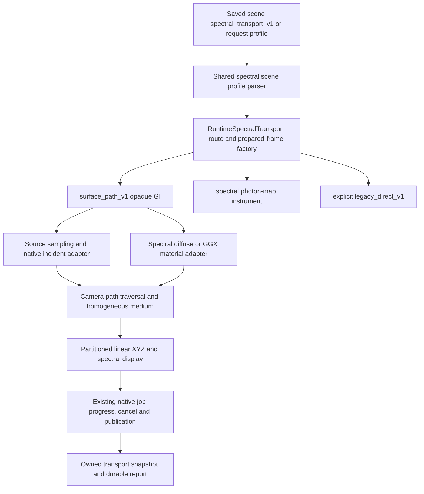

# Ordinary V3 transport backend

Disney V3 selects the qualified opaque spectral transport path for ordinary
supported scenes. Editor jobs, native rendering and local headless v2 requests
share the profile parser, frame factory, traversal, film conversion and report.
This is a local source integration; it does not change installed releases or
enable remote spectral jobs.

## Route and ownership



| Owner | Contract |
| --- | --- |
| `app/spectral_scene_profile.c` | Parses optical policy independently of CLI request envelopes. Resolves scene-relative assets and source ownership. |
| `render/runtime_spectral_transport.c` | Resolves one estimator, admits the frame, distinguishes preview/final cost, and captures owned terminal diagnostics. |
| `render/runtime_spectral_surface_path_source.c` | Samples explicit source spectra or adapts the existing native incident-light API. |
| `render/runtime_spectral_surface_path_material.c` | Evaluates and samples opaque diffuse/GGX response. Explicit spectral tables and native RGB approximation remain identifiable. |
| `render/runtime_spectral_surface_path.c` | Traverses camera-to-light paths, applies medium/visibility/continuation/MIS/roulette, and commits pixels in bounded strips. |
| `render/runtime_spectral_surface_path_diagnostics.c` | Serializes stable component, termination and optional single-path evidence. |
| Native prepared frame / scheduler / async job | Own geometry, exclusive execution, cancellation, progress and verified image publication. |
| `editor/scene_editor_spectral_profile.c` | Changes retained policy through scene revision guards and the existing Undo/Redo transaction. |

The frame owns its profile, prepared spectrum, mapping, query mutex and readout.
Transport borrows the frame's geometry only while that frame exists; it rebinds
the scene after prepared-frame moves into job storage. Snapshots contain owned
values, clear borrowed caches, and outlive frame teardown. A terminal snapshot
requires joined/exclusive execution. Reads during a job use immutable settings,
not a concurrent copy of mutable tracing counters.

## Default and explicit alternatives

An absent profile selects `surface_path_v1`, with 512 camera samples, 12 surface
interactions, seed 19 and `spectral_soft_v1`. A new scene explicitly created with
the V3 preset saves `{"quality_profile":"surface_path_v1"}`. Selecting V3 in an
old supported scene activates the same policy. Direct Light and V2 keep their
own behavior; the global new-scene selection is unchanged.

Save policy in `extensions.ray_tracing.spectral_transport_v1`. For example:

```json
{
  "quality_profile": "surface_path_v1",
  "surface_path_v1": {
    "samples": 1024,
    "max_depth": 12,
    "seed": 19,
    "path_trace": {"x": 32, "y": 24, "sample": 0}
  }
}
```

Omitting `materials` adapts native opaque RGB materials. Omitting `light` adapts
the enabled native incident sources. Both omissions are explicit compatibility
boundaries, recorded as `native_rgb_basis_approximation`; RGB does not uniquely
specify a physical spectrum. Native materials use normalized diffuse and
single-GGX weights, not a complete layered/coated Disney model. Native source
sampling retains legacy intensity/falloff or physical rectangular radiance,
as declared by the source. A compatibility point source is not relabeled as
inverse-square radiant power. Native lights are sampled by NEE and are not
made camera-visible emitting geometry by this adapter.

Explicit source and reflectance tables retain their qualified spectral
semantics. A supplied explicit `light` owns illumination; a nonempty ordinary
scene light list then fails validation. A saved calibration photon-map profile selects its existing glass/receiver/volume estimator. The ordinary smooth glass profile builds its own area-source surface map within the camera path. When the saved profile includes a homogeneous exterior fog box, the same launch stream supplies attenuated surface deposits and a separate first-scatter volume estimate.
The two-surface and pencil controls remain explicit calibration instruments.
Use `{"quality_profile":"legacy_direct_v1"}` for the previous direct spectral
approximation. No unsupported scene silently falls back to that route.

Interactive preview uses the same opaque physics with one camera sample and
no final-film probes. Its report distinguishes `interactive_preview`, effective
samples and originally requested final samples. Final jobs use the saved
profile. The frame panel's **Samples (0=scene)** is an explicit job override;
zero preserves the scene policy. This is separate from photon-map passes and
temporal accumulation.

## Admission and reproducibility

Opaque transport admits 1–32 planes, boxes or native mesh instances,
up to 32 supported native sources, and optional explicit homogeneous HG box
media. A saved `smooth_glass` material admits one closed dielectric mesh with
matte planes, one explicit rectangular area light and an optional homogeneous
exterior fog box. Its ordinary V3 render builds the surface caustic map by
default and reports the first-scatter volume contribution, map ownership and
subsequent matte bounce separately. See the [smooth glass profile](spectral_surface_path.md#smooth-glass-and-surface-caustics).

Other transmission models, emissive materials, microdetail normals, curves,
generic volumes/atmosphere, unsupported emitter adapters, nested media,
checkpoint/resume and temporal accumulation refuse admission. Ordinary native
sources support point/sphere-proxy and rectangular incident sampling. Explicit
spectral sources support one area or sky-cap source in the opaque path.

Film bounds are 1–4096 per dimension, samples 1–8192, depth 1–12 and
`width * height * samples * depth <= 1200000000`. A high-resolution default job
may exceed this qualified bound: choose an explicit sample/depth budget before
rendering. No quality reduction is hidden. These are qualified limits, not
arbitrary-scene production scalability or convergence guarantees.

Keep source snapshot/hash, assets, effective profile, film camera, build identity
and transport report with an image. The retained profile and V3 preset survive
ordinary generated-overlay Save, Undo/Redo and reopening. A per-job sample
override is recorded in its settings without rewriting the saved scene.

## Diagnostic readback

`spectral_transport` uses schema `optic_v3_transport_v1`. It records the selected
route, execution status, estimator, spectral approximation, source IDs and
radiometry, quality, film/projector, and component partition. The primary fields
are shared by headless summaries and native job receipts. Historical
`spectral_execution` / `spectral_surface_path` fields remain for compatibility;
use the shared report for backend classification.

Editor `job.json` contains a compact report plus `spectral_transport_path` and
`spectral_transport_sha256`. The full `transport.json` sidecar includes any path
events. Receipt retries use the owned snapshot and the same ID; they do not
rerender. Canceled jobs publish no final image and retain partial diagnostic
counts. These describe sampled paths/pixels, not a completed film.
Transport status describes kernel execution; the enclosing job's status and
artifact verification describe publication. A completed kernel can therefore
accompany a failed image publication. Neither implies a converged image.

1. Check `route`, `status`, `diagnostic` and `purpose` before comparing images.
2. Check source IDs/radiometry and material representation before calling a
   result a measured spectral response.
3. Compare unexposed `film_components_xyz`: `direct`, `surface_indirect` and
   `volume` sum to `total`. Volume contains any path with a medium scatter;
   surface-indirect contains additional surface continuations without one.
4. Inspect `termination`: source hit, dark escape, zero throughput, medium
   absorption, backface, BSDF rejection, roulette and depth/event caps account
   for every successfully started path. Event closure is not a watt ledger.
5. Enable `path_trace` for one pixel/sample. At most 128 events include origin,
   direction, vacuum wavelength, throughput, object/source and occluder IDs,
   normal, PDF/measure, source weight, MIS, transmission and roulette factors.
   `truncated` is explicit. Diagnostics consume no random dimensions.
6. Replay scalar contributions from their declared factors, then apply the
   camera event's wavelength weight, CIE observer and sample average. A trace
   is one stochastic path, not a convergence or whole-scene energy proof.

The MCP catalog exposes `render_profile_read`, revision-guarded
`render_profile_set`, and `render_start_v3` with `camera_samples_override`
(0 preserves scene). Existing `render_start` V3 calls also use the scene policy.
Profile editing refuses an active render or interaction. Save uses the retained
profile owner rather than reconstructing spectra from UI caches.

## Qualification

The [visible spectral material response bench](spectral_material_response.md)
uses this route for matched saved-scene renders, independent spectral-product
integration, same-white source controls and direct/indirect shadow comparisons.

`make test-headless-spectral-native` checks saved/request image identity,
absent/pinned default identity, native source power/distance response, native
material passivity, diagnostic noninterference/replay, component/termination
closure, explicit rollback and invalid-input refusal. The independent physical
controls remain `make test-headless-spectral-surface-path`.

For native proof, build `scene-editor-workspace-visual-test` and run
`tests/integration/test_editor_spectral_transport.py --cli <cli> --harness <test>
--output <fresh-root>` with a window server. It exercises actual profile
commands/history, generated-overlay Save, standard jobs, native panel controls,
in-flight cancellation, post-teardown reports and fresh-process reopening.
A lit fixed-camera native/headless replay requires identical RGBA; projector
and path-report scalars allow 1e-12 roundoff from direction/look-at conversion.
Run the same tests under ASan/UBSan for lifetime/undefined-behavior proof.
